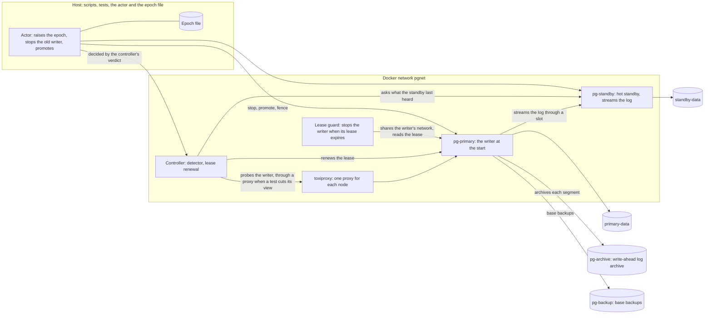

# Architecture

This page shows what runs when the stack is up and which part does what. It is a picture of the laboratory, not of a production design. The terms are in the [glossary](glossary.md).

## The stack

Docker Compose starts three containers on one network, `pgnet`. The primary and the standby are PostgreSQL 16 nodes. Toxiproxy is idle until a test points a connection at one of its proxies.

The controller and the lease guard are not part of the Compose file. A test starts each one with `docker run` when it needs one. The actor and the epoch file live on the host, because the actor is a script that a test runs and can kill.

## What each part is for

| Part | Job | Where it is defined | Pattern |
|---|---|---|---|
| Primary and standby | Hold the data. One writes and the other follows. | [docker-compose.yml](../pg-replication/docker-compose.yml) | None. |
| Replication slot | Keeps the log that the standby has not received. | The compose file and the promote script. | None. |
| Toxiproxy | Injects delay, jitter, bandwidth limits, silence and cut links. | [proxies.json](../pg-replication/toxiproxy/proxies.json) | [Negative control](../pg-replication/docs/patterns/negative-control.md). |
| Controller | Probes the writer, asks the standby what it last heard, and renews the lease. | [failover_controller](../services/failover_controller/main.py) | [Witness detector](../pg-replication/docs/patterns/witness-detector.md). |
| Lease guard | Stops a writer whose lease has expired. | [fence_guard](../services/fence_guard/main.py) | [Lease and guard](../pg-replication/docs/patterns/lease-and-guard.md). |
| Actor | Carries out one failover in three steps, and can be killed and run again. | [actor.sh](../pg-replication/lib/actor.sh) | [Restartable actor](../pg-replication/docs/patterns/restartable-actor.md). |
| Epoch file | Orders the failovers. | [epoch.sh](../pg-replication/lib/epoch.sh) | [Epoch](../pg-replication/docs/patterns/epoch-fencing-token.md). |
| Archive and base backups | Allow point-in-time recovery. | [backup.sh](../pg-replication/lib/backup.sh) | None. |

## What is not here

The stack has no application service, no router, no broker and no checker. A client reaches a node directly. The measured downtime is therefore the time until a write succeeds on some node. A router and a service layer belong to Phases 2 and 3 in the [roadmap](../README.md).

## Related diagrams

- The [role state machine](../pg-replication/docs/diagrams/role-state-machine.md) shows which script moves a node between writer, replica and stopped.
- The [failover sequence](../pg-replication/docs/diagrams/failover-sequence.md) shows the 17-step round trip.
