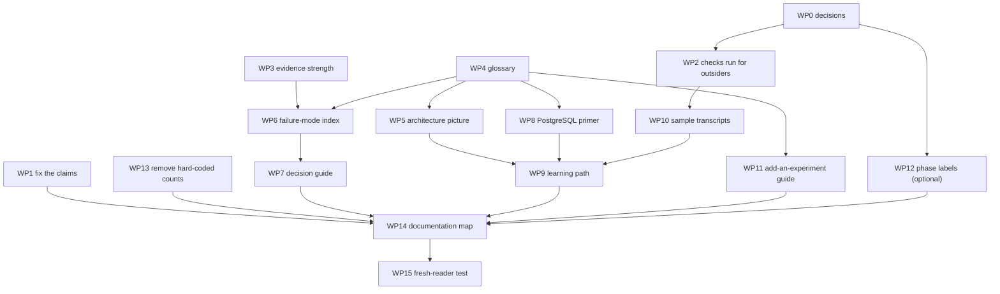

# Documentation plan: from a record of evidence to a reference and a course

This plan turns the critical review of the documents into work that can be done one step at a time. Each step is a work package, written WP1, WP2 and so on. Each work package ends in one commit. The status column shows what is done.

## Aim

The repository should answer three questions for a stranger. What does it prove? How can I look something up in it? How can I learn from it? Today it answers the first well. It answers the second and third only in part.

## Findings that the plan closes

1. The README promises material for a Target Operating Model, with a risk register and consistency tiers. Neither document exists.
2. The opening sentences of the README and CLAUDE.md claim more than the repository shows.
3. The fast checks fail for a reader who lacks the private bash-standard plugin.
4. The register does not show how many runs support each claim.
5. Nothing is indexed by failure. There is no glossary, no architecture picture and no decision guide.
6. There is no learning path, no PostgreSQL primer, no sample output and no exercise.
7. The README hard-codes counts that will drift.

## Dependency order

## Work packages

Sizes are small (S, under an hour), medium (M, one to three hours) and large (L, a half day).

| ID | Work package | Deliverable | Depends on | Size | Status |
|---|---|---|---|---|---|
| WP0 | Decisions | Four answers, listed below. | None. | S | Done on 2026-11-25. |
| WP1 | Fix the claims | Reworded openings in `README.md` and `CLAUDE.md`. The Target Operating Model sentence says what exists. The headline says when data is and is not lost. | None. | S | Done on 2026-11-25. |
| WP13 | Remove hard-coded counts | The README no longer states the number of capabilities or tests. | None. | S | Done on 2026-11-25. |
| WP3 | Evidence strength | New columns in the register for the number of runs and the date of the last run. The values come from the evidence log. | None. | M | Open. |
| WP4 | Glossary | `docs/glossary.md` defines each term once: writer, replica, actor, controller, guard, lease, epoch, fence, witness, slot, timeline and the rest. | None. | M | Open. |
| WP2 | Checks run for outsiders | `run-all-checks.sh` reports the lint as skipped when the plugin is absent, and everything else still runs. The README explains this. | WP0 | M | Open. |
| WP5 | Architecture picture | A diagram in the README and `docs/architecture.md`. It shows the containers, the volumes, the proxy, the controller, the guard and the archive. | WP4 | M | Open. |
| WP8 | PostgreSQL primer | `docs/primer-postgresql-replication.md`, two pages on the write-ahead log, slots, timelines, promotion and `pg_rewind`, with links to the official documentation. | WP4 | M | Open. |
| WP6 | Failure-mode index | `docs/failure-modes.md`. Each row gives a fault, its effect, how it is detected, what mitigates it, the test, the register row and the remaining risk. It seeds the risk register. | WP3, WP4 | L | Open. |
| WP7 | Decision guide | `docs/decision-guide.md` says when to choose each replication mode, how to set the lease time and the timeouts, and when to use backup and not replication. | WP6 | M | Open. |
| WP10 | Sample transcripts | `docs/transcripts/` holds real output from four tests, with notes. Each file records the date and the commit of the run. | WP2 | M | Open. |
| WP9 | Learning path | `docs/learning-path.md` has seven labs in order. Each lab has prerequisites, a question to answer before running, the command, the expected result, an exercise and the time it takes. | WP5, WP8, WP10 | L | Open. |
| WP11 | Add-an-experiment guide | `docs/adding-an-experiment.md` sets out the template. It covers the hypothesis, the fault, the expected behaviour, the pass criterion, the abort condition, the control, the restore and the register row. | WP4 | M | Open. |
| WP12 | Phase labels (optional) | One definition of each phase, used in every document, so that "complete" has one meaning. | WP0, WP3 | M | Open. |
| WP14 | Documentation map | `docs/README.md` lists every document by purpose and audience. The root README points to the glossary, the failure modes, the learning path and the map. | WP1, WP7, WP9, WP11, WP12, WP13 | S | Open. |
| WP15 | Fresh-reader test | A clean clone follows the README exactly. Every command, link and claim is checked, and the faults found are fixed. | WP14 | M | Open. |

## Execution waves

The waves group work that can start together. Work inside a wave can happen in any order.

1. **Wave A: credibility.** Do WP0, WP1, WP13, WP3 and WP4. None of these depends on another.
2. **Wave B: first use.** Do WP2, WP5 and WP8. They need WP0 or WP4.
3. **Wave C: reference.** Do WP6 and then WP7.
4. **Wave D: teaching.** Do WP10, then WP9, and WP11 beside them.
5. **Wave E: wrap-up.** Do WP12 if it is wanted, then WP14 and WP15.

## Decisions for WP0

The owner accepted all four recommendations on 2026-11-25.

| # | Question | Decision |
|---|---|---|
| D1 | The bash-standard and compose-standard plugins are private. Should the lint be skipped when they are absent, or should the checker be published or copied into the repository? | Skip with a clear message now. Revisit publication later. |
| D2 | Should the phase labels stay as they are, or be redefined? | Keep them for now, and decide again at WP12. |
| D3 | Should this plan stay in `docs/`, or move out of the public tree when it is finished? | Keep it in `docs/` while work is open, and delete it when every status reads done. |
| D4 | Should sample transcripts keep their real timestamps and identifiers? | Yes. Real output is the point, and only the throwaway credentials appear in it. |

## Rules for every work package

- One work package makes one commit. The message names the package.
- Run `bash pg-replication/scripts/check-docs.sh` after every change to a document. Run `run-all-checks.sh` after any change to a script.
- Write in British English, with short sentences, a full stop at the end of each sentence, and every term expanded on first use.
- A new claim must link to the test or the register row that supports it. A document that cannot do that does not make the claim.
- Update the status column and the "Current state" section of `CLAUDE.md` in the same commit.

## Risks

- **Drift.** A new document repeats numbers from the register. Link to the register instead of copying where you can.
- **Stale transcripts.** A transcript shows one run. It states the date and the commit, and a later change to a test can make it out of date.
- **Scope growth.** The failure-mode index can grow without end. Limit it to faults that a test in this repository exercises, and list the rest as open.
