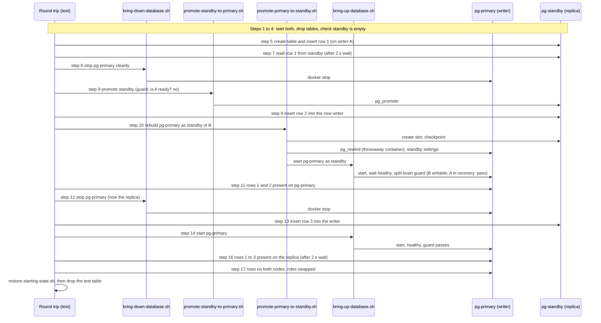

# Failover sequence: the 17-step round trip

The script [test-failover-roundtrip.sh](../../scripts/test-failover-roundtrip.sh) runs the full cycle. It replicates a row, fails over, rejoins the old primary, writes while a node is down, and compares the two nodes. The diagram shows the calls and the check at each step. The step numbers match the test's own output.

The container names `pg-primary` and `pg-standby` never change. After a failover, `pg-standby` is the writer. Step 12 stops the container named `pg-primary`, which is then the **replica**. The roles swap, and the names do not.

## What each check proves

| Step | Check | Pattern |
|---|---|---|
| 7 | Row 1 is on the standby. | [Verify after act](../patterns/verify-after-act.md) |
| 9 | The promotion guard passed because the primary was stopped, and the new writer accepts row 2. | [Promotion guard](../patterns/promotion-guard.md) |
| 10 | The old primary rejoined, and the split-brain guard let it start as a standby. | [Split-brain guard](../patterns/split-brain-guard.md) |
| 11, 16 and 17 | Every row is on both nodes, and the roles are as expected. | [Verify after act](../patterns/verify-after-act.md) |

## Known weak points, in the order that a learner should meet them

1. **Fixed waits.** Steps 3, 6 and 15, and the wait after step 10, sleep for 2 seconds. A slow node fails the test and is not waited for. [Verify after act](../patterns/verify-after-act.md) explains the stronger alternative.
2. **Check then act between steps 8 and 9.** The guard checks the primary once and then promotes. Nothing in the round trip stops the old primary coming back in between. The promotion now fences the old primary's data directory, so a restarted node comes up read-only. The [promotion guard](../patterns/promotion-guard.md) lists the remaining limit.
3. **Failure during the test.** If the run is interrupted, the cleanup runs `restore-starting-state.sh`. The [role state machine](role-state-machine.md) holds its decision table.
