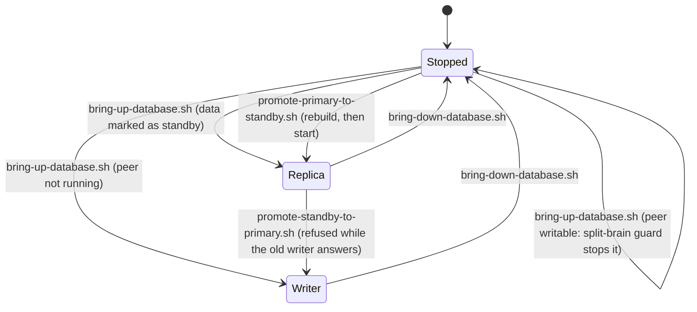

# Role state machine

Each database node is in one of three states, judged from the running container and `pg_is_in_recovery()`:

- **Writer:** running, accepts writes (`pg_is_in_recovery()` is `f`).
- **Replica:** running, a standby that replays WAL and rejects writes (`t`).
- **Stopped:** the container is not running.

The starting state of the stack is one writer (`pg-primary`) and one replica (`pg-standby`).

## Transitions per node

| Transition | Script | Guard or precondition |
|---|---|---|
| Writer or Replica to Stopped | [bring-down-database.sh](../../scripts/bring-down-database.sh) | Clean stop with a 30 s timeout, then confirmed stopped |
| Stopped to Replica | [bring-up-database.sh](../../scripts/bring-up-database.sh) | The data directory was rebuilt as a standby, so Postgres starts in recovery |
| Stopped to Replica | [promote-primary-to-standby.sh](../../scripts/promote-primary-to-standby.sh) | The old writer must be stopped, the other node must accept writes; `pg_rewind` then standby settings, then start |
| Stopped to Writer | [bring-up-database.sh](../../scripts/bring-up-database.sh) | [Split-brain guard](../patterns/split-brain-guard.md) passes because the peer is not running |
| Stopped to Stopped (refused) | [bring-up-database.sh](../../scripts/bring-up-database.sh) | [Split-brain guard](../patterns/split-brain-guard.md): the node was writable and the peer is writable, so it is stopped again |
| Replica to Writer | [promote-standby-to-primary.sh](../../scripts/promote-standby-to-primary.sh) | [Promotion guard](../patterns/promotion-guard.md): refused while the old writer answers, unless `--force` |

## Pairs: the restore script's decision table

[restore-starting-state.sh](../../scripts/restore-starting-state.sh) reads both nodes and acts on the pair
`primary/standby` (the container names, not the roles). This is the table it implements:

| Primary / standby now | Action |
|---|---|
| writer / replica | None: already the starting state |
| writer / stopped | Start the standby through `bring-up-database.sh` |
| stopped / replica | Start the primary through `bring-up-database.sh` |
| stopped / writer, replica / writer, replica / stopped | Fail back: rebuild, promote, rebuild (`fail_back`) |
| anything else | Refuse with "repair by hand" (exit 1) |

## How to check this diagram

Each arrow names the script that makes the change. To confirm an arrow still holds, read that script's function that
changes the state, for example `promote_standby` for Replica to Writer. A new script that changes a role should add
its arrow here, or the diagram becomes a lie.
