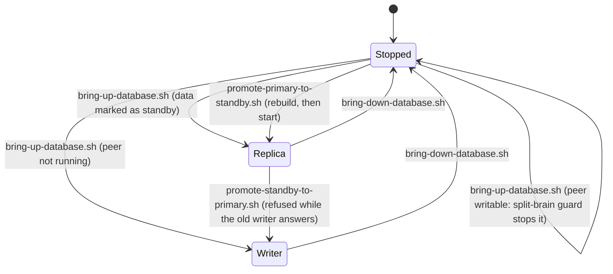

# Role state machine

Each database node is in one of three states. The state comes from the running container and from `pg_is_in_recovery()`.

- **Writer:** The node is running and accepts writes. The value of `pg_is_in_recovery()` is `f`.
- **Replica:** The node is running as a standby. It replays the write-ahead log (WAL) and rejects writes. The value is `t`.
- **Stopped:** The container is not running.

The starting state of the stack is one writer, `pg-primary`, and one replica, `pg-standby`.

## Transitions for one node

| Transition | Script | Guard or precondition |
|---|---|---|
| Writer or Replica to Stopped. | [bring-down-database.sh](../../scripts/bring-down-database.sh) | A clean stop with a 30-second timeout, followed by a check that the node is stopped. |
| Stopped to Replica. | [bring-up-database.sh](../../scripts/bring-up-database.sh) | The data directory was rebuilt as a standby, so PostgreSQL starts in recovery. A fenced node also starts as a replica. |
| Stopped to Replica. | [promote-primary-to-standby.sh](../../scripts/promote-primary-to-standby.sh) | The old writer must be stopped, and the other node must accept writes. The script runs `pg_rewind` or a clone, writes the standby settings, and then starts the node. |
| Stopped to Writer. | [bring-up-database.sh](../../scripts/bring-up-database.sh) | The [split-brain guard](../patterns/split-brain-guard.md) passes because the peer is not running. |
| Stopped to Stopped, which is a refusal. | [bring-up-database.sh](../../scripts/bring-up-database.sh) | The [split-brain guard](../patterns/split-brain-guard.md) found the node writable and the peer writable, so it stops the node again. |
| Replica to Writer. | [promote-standby-to-primary.sh](../../scripts/promote-standby-to-primary.sh) | The [promotion guard](../patterns/promotion-guard.md) refuses while the old writer answers, unless `--force` is given. |

## Pairs: the restore script's decision table

[restore-starting-state.sh](../../scripts/restore-starting-state.sh) reads both nodes and acts on the pair `primary/standby`. The pair uses the container names, not the roles. The table shows what the script does.

| Primary and standby now | Action |
|---|---|
| Writer and replica. | If the standby is not streaming, rebuild it. Otherwise the stack is already in the starting state. |
| Writer and stopped. | Start the standby through `bring-up-database.sh`. Rebuild it if it does not start safely or does not stream. |
| Stopped and replica. | Start the primary through `bring-up-database.sh`. |
| Stopped and writer, replica and writer, or replica and stopped. | Fail back. Rebuild, promote, and rebuild again (`fail_back`). |
| Stopped and stopped. | Start the writer candidate first, and then restore again from the new pair. The candidate is the node without the replica marker `standby.signal`. If both nodes or neither have it, the node on the newer timeline is the candidate. |
| Anything else. | Refuse with the message "repair by hand" and exit with status 1. |

## How to check this diagram

Each arrow names the script that makes the change. To confirm that an arrow still holds, read the function in that script that changes the state. For example, read `promote_standby` for the change from Replica to Writer. A new script that changes a role must add its arrow here. Otherwise the diagram becomes untrue.
