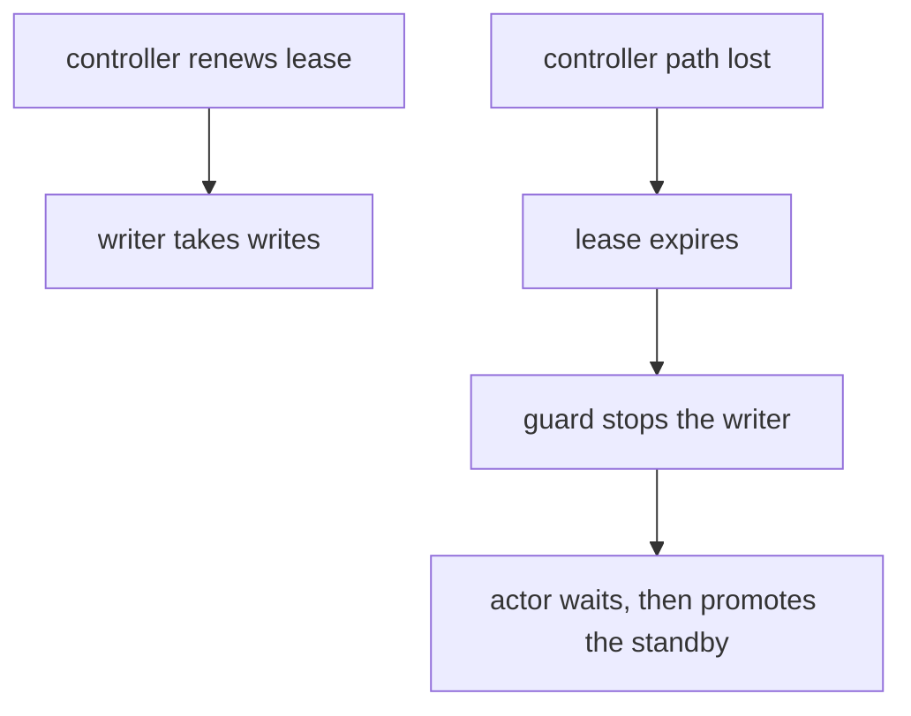

# Lease and guard

**Pattern:** a writer may take writes only while it holds a lease that something else keeps renewing; a guard beside it stops the writer when the lease runs out.

## Problem

The old writer is cut off from the controller but still running, and cannot be killed (a partition, a hung host). Promoting the
standby would create two writers. Waiting for the writer to "come back" is not a plan.

## Mechanism

| Where | What it does |
|---|---|
| [lib/lease.sh](../../lib/lease.sh), `lease::install` | Creates the lease row on the writer with its epoch and expiry |
| failover controller, the lease-renewal function ([services/failover_controller/probe.py](../../../services/failover_controller/probe.py)) | Renews the expiry each round, using the writer's own clock, while the writer answers and is not a replica |
| [services/fence_guard/decision.py](../../../services/fence_guard/decision.py), the should-fence function | Pure decision: stop the node only if it accepts writes **and** its lease has expired. A replica, or a node with no lease, is never fenced |
| [lib/lease.sh](../../lib/lease.sh), `lease::guard_start`, `lease::guard_stop` | Run the guard in a sidecar container that shares the writer's network, polling every 0.5 s |
| [lib/lease.sh](../../lib/lease.sh), `lease::install_write_check` | Puts a trigger on a table that reads the lease inside every write and refuses it once the lease has expired, so the refusal happens at the resource, at the moment of the write, whatever the guard is doing |
| [act-on-failover.sh](../../scripts/act-on-failover.sh), `stop_old_writer` | Where the old writer cannot be reached, waits for its lease to run out instead of killing it |
| same script, `hand_over_lease` | Gives the new writer its own lease and guard, and repoints the controller |

## Guards against

A partitioned but running old writer taking writes while a new writer takes over.

## Evidence

- **LEASE-01:** cut off, the writer's last write was accepted 5.3 s after the cut and the first was refused at 5.6 s. **Control (no guard):** it still accepted writes 13.9 s later.
- **LEASE-02:** isolated old writer, no overlap with the new one (gap 8.8 to 9.6 s). **Control:** 14 to 16 s of two writers.
- **LEASE-03:** the new writer's lease is renewed, and fences it when renewals stop.
- **CTL-01:** a controller back within the lease time costs nothing.
- **LEASE-04:** a writer frozen for 8 s with a 5 s lease and a client write waiting: with no check the write was accepted 3.1 s after expiry; with the check it was refused ("fenced") and nothing was written.
- **LEASE-05:** the fail-back hands the lease back at epoch 2.

## Limits

- **It trades availability for safety.** Any loss of the controller's path, or a controller outage longer than the lease time, stops a healthy writer. Set the lease time well above the controller's restart time.
- **A paused process that resumes can write once** before its guard looks: the guard polls from outside, and a lease cannot see a process that was frozen while it ran out. The write check closes this for the tables that carry it (see below); it is opt-in per table, reads the node's own clock, and does not compare epochs (GAP-03).
- The guard polls, so a write can slip in up to one poll interval after expiry.
- The lease row lives on the writer it protects and the controller is single. Replicating the controller needs a consensus store.

## Related

[Epoch](epoch-fencing-token.md), [Split-brain guard](split-brain-guard.md) (fencing at start time), [Witness detector](witness-detector.md).
