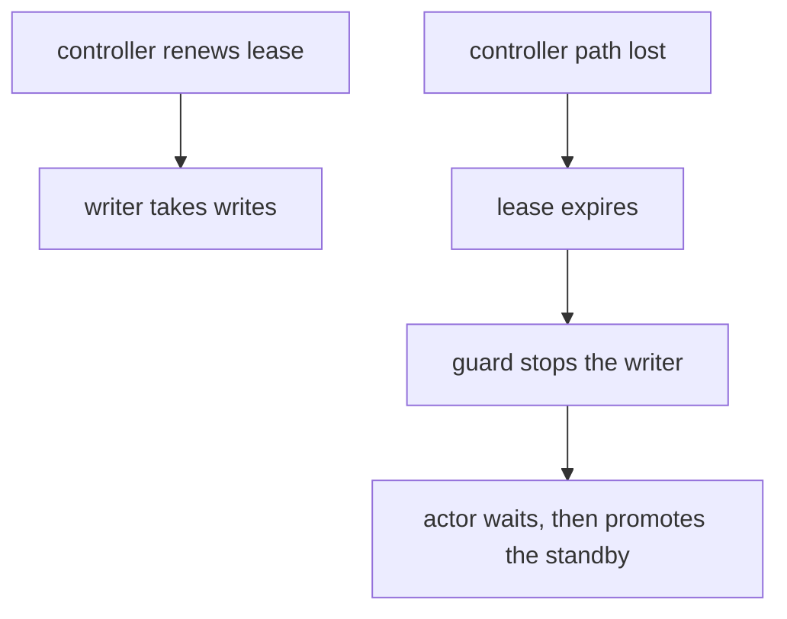

# Lease and guard

<!-- toc -->

- [Problem](#problem)
- [Mechanism](#mechanism)
- [Guards against](#guards-against)
- [Evidence](#evidence)
- [Limits](#limits)
- [Related](#related)

<!-- tocstop -->

**Pattern:** a writer may take writes only while it holds a lease that something else keeps renewing. A guard beside the writer stops it when the lease runs out.

## Problem

The old writer is cut off from the controller, but it is still running and cannot be killed. This can happen in a partition or on a hung host. Promoting the standby would create two writers. Waiting for the writer to come back is not a plan.

## Mechanism

| Where | What it does |
|---|---|
| [lib/lease.sh](../../lib/lease.sh), `lease::install` | Creates the lease row on the writer, with its epoch and expiry. |
| The failover controller, in its lease-renewal function in [services/failover_controller/probe.py](../../../services/failover_controller/probe.py) | Renews the expiry each round, using the writer's own clock. It renews only while the writer answers and is not a replica. |
| The should-fence function in [services/fence_guard/decision.py](../../../services/fence_guard/decision.py) | Makes a pure decision. It stops a node only if the node accepts writes and its lease has expired. It never fences a replica or a node with no lease. |
| [lib/lease.sh](../../lib/lease.sh), `lease::guard_start` and `lease::guard_stop` | Run the guard in a sidecar container that shares the writer's network. The guard polls every 0.5 seconds. |
| [lib/lease.sh](../../lib/lease.sh), `lease::install_write_check` | Puts a trigger on a table. The trigger reads the lease inside every write and refuses the write once the lease has expired. The refusal happens at the resource, at the moment of the write, whatever the guard is doing. |
| [act-on-failover.sh](../../scripts/act-on-failover.sh), `stop_old_writer` | Where the old writer cannot be reached, it waits for the lease to run out instead of killing the writer. |
| Same script, `hand_over_lease` | Gives the new writer its own lease and guard, and repoints the controller. |

## Guards against

A partitioned but running old writer can take writes while a new writer takes over. The lease and the guard prevent that.

## Evidence

- **LEASE-01.** After the cut, the writer's last write was accepted 5.3 seconds later, and the first refusal came at 5.6 seconds. In the control there was no guard, and the writer still accepted writes 13.9 seconds later.
- **LEASE-02.** An isolated old writer had no overlap with the new one, with a gap of 8.8 to 9.6 seconds. In the control, two writers ran for 14 to 16 seconds.
- **LEASE-03.** The new writer's lease is renewed, and it fences the writer when the renewals stop.
- **CTL-01.** A controller that is back within the lease time costs nothing.
- **LEASE-04.** A writer was frozen for 8 seconds with a 5-second lease and a client write waiting. With no check, the write was accepted 3.1 seconds after expiry. With the check, the write was refused with the message "fenced", and nothing was written.
- **LEASE-05.** The fail-back hands the lease back at epoch 2.

## Limits

- **The pattern trades availability for safety.** Any loss of the controller's path stops a healthy writer. So does a controller outage that is longer than the lease time. Set the lease time well above the controller's restart time.
- **A paused process that resumes can write once before its guard looks.** The guard polls from outside, and a lease cannot see a process that was frozen while it ran out. The write check closes this gap for the tables that carry it. The check is opt-in for each table, it reads the node's own clock, and it does not compare epochs (GAP-03).
- The guard polls, so a write can slip in up to one poll interval after the expiry.
- The lease row lives on the writer that it protects, and the controller is single. Replicating the controller needs a consensus store.

## Related

[Epoch](epoch-fencing-token.md), the [split-brain guard](split-brain-guard.md), which fences at start time, and the [witness detector](witness-detector.md).
