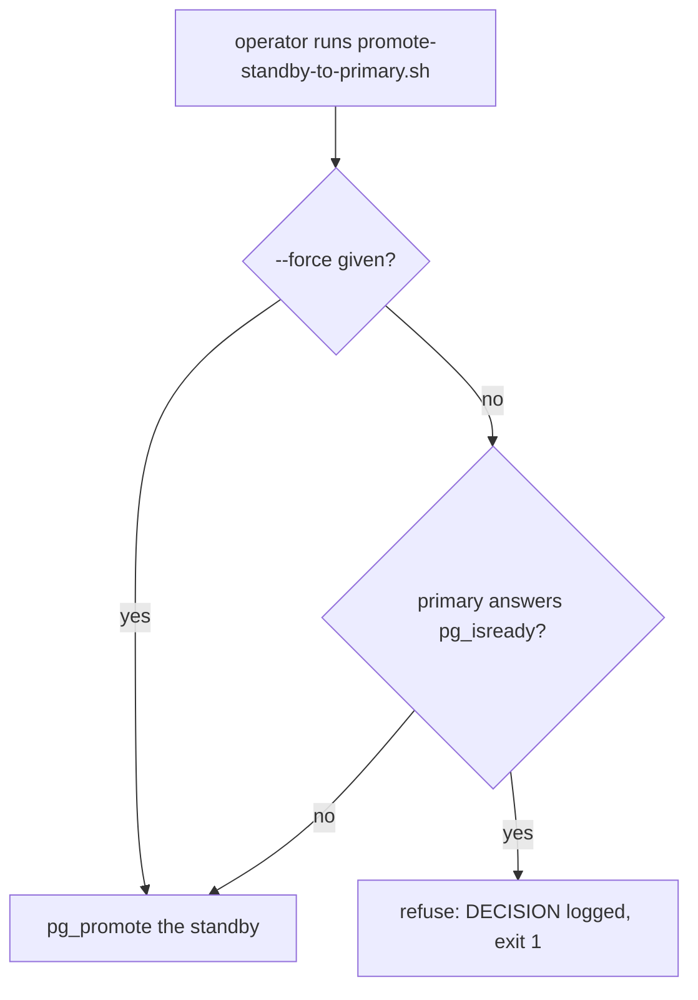

# Promotion guard

**Pattern:** refuse a destructive action while the thing it would displace still answers.

## Problem

Promoting the standby to writer while the old primary still accepts writes gives the system two writers. Writes
then diverge on each side, and the old primary can only rejoin after a rebuild that discards its extra writes.

## Mechanism

| Where | What it does |
|---|---|
| [promote-standby-to-primary.sh](../../scripts/promote-standby-to-primary.sh), `main` | Runs the check unless `--force` is given |
| same script, `check_primary_unreachable` | Probes the primary. If it answers, logs `DECISION: refused to promote` and stops with exit 1 |
| same script, `promote_standby` | The action: `pg_promote`. It runs only after the check has passed |
| [lib/database.sh](../../lib/database.sh), `database::is_ready` | The probe: `pg_isready` run inside the primary's container |

## Guards against

An operator promotes during a fault that looks like a dead primary, but the primary is still up (a network blip,
a hung process that still accepts connections, or a restart that has not finished).

## Evidence

- **FOV-02** in the capability register (manual, 2026-11-14): with the primary running, the script exited 1 with
  "Primary 'pg-primary' is still accepting connections", and the standby stayed in recovery.
- The 17-step round trip stops the primary first (step 8), so the check passes and the promotion goes ahead.

## Limits

- **Check, then act, is not atomic.** The primary can come back between the probe and `pg_promote`. Only fencing (a
  token the old primary must hold to write) closes that gap. This is gap GAP-03, planned for Phase 2.
- **`--force` and a direct `pg_promote` bypass the check.** The guard is a guard rail for the operator, not a
  lock.
- **The probe cannot tell a hung primary from a dead one.** Both fail `pg_isready`, or one fails and the other
  does not. A hung primary that still holds its data files is not detected.
- **A stopped container counts as unreachable**, because `docker exec` fails. That is the intended result for this
  check, but it is a fact to remember when reading the refusal message.

## Related

[Split-brain guard](split-brain-guard.md) (the same idea applied when a node comes back), and
[Verify after act](verify-after-act.md).
