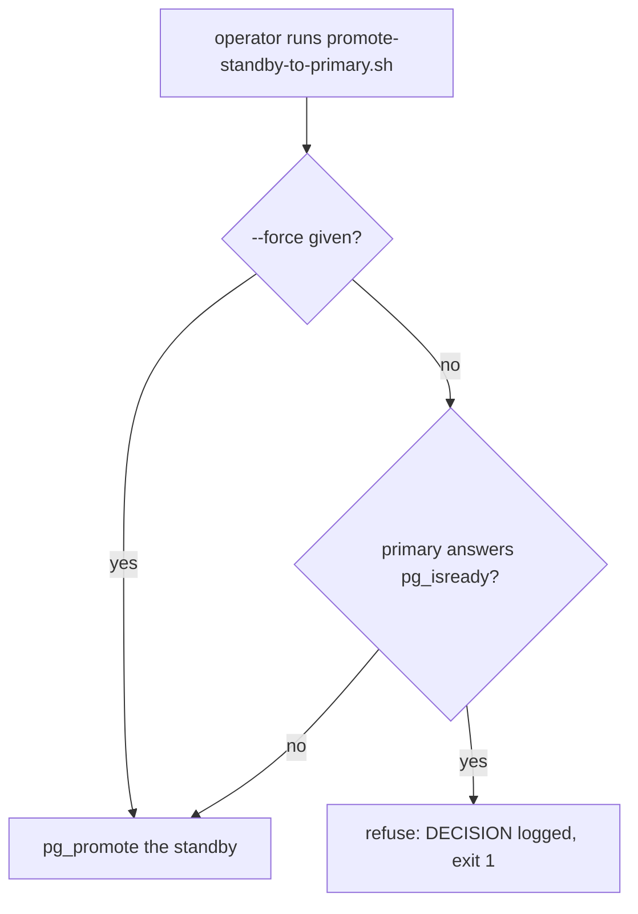

# Promotion guard

**Pattern:** refuse a destructive action while the thing that it would displace still answers.

## Problem

Suppose the standby becomes the writer while the old primary still accepts writes. The system then has two writers. Writes diverge on each side. The old primary can rejoin only after a rebuild that discards its extra writes.

## Mechanism

| Where | What it does |
|---|---|
| [promote-standby-to-primary.sh](../../scripts/promote-standby-to-primary.sh), `main` | Runs the check unless `--force` is given. |
| Same script, `check_primary_unreachable` | Probes the primary. If the primary answers, it logs `DECISION: refused to promote` and stops with exit status 1. |
| Same script, `promote_standby` | Performs the action, which is `pg_promote`. It runs only after the check has passed. |
| [lib/database.sh](../../lib/database.sh), `database::is_ready` | Provides the probe, which is `pg_isready` run inside the primary's container. |

## Guards against

An operator may promote during a fault that looks like a dead primary while the primary is still up. The primary may have suffered a network blip, a hung process that still accepts connections, or a restart that has not finished.

## Evidence

- **FOV-02** is automated by `test-guards.sh`. With the primary running, the promotion was refused, the standby stayed a replica, and the primary stayed the writer. The first observation was made by hand on 2026-11-14.
- The 17-step round trip stops the primary first, in step 8. The check therefore passes, and the promotion goes ahead.

## Limits

- **Check then act is not atomic.** The primary can come back between the probe and `pg_promote`. Only fencing closes that gap, because fencing needs a token that the old primary must hold to write. The lease, the guard and the epoch now fence a running old writer, as the [lease and guard](lease-and-guard.md) page describes. The part that is still open is an epoch check in every write (GAP-03).
- **`--force` and a direct `pg_promote` bypass the check.** The guard is a guard rail for the operator. It is not a lock.
- **The probe cannot tell a hung primary from a dead one.** A hung primary that still holds its data files is not detected.
- **A stopped container counts as unreachable**, because `docker exec` fails. That is the intended result for this check. Remember it when you read the refusal message.

## Related

The [split-brain guard](split-brain-guard.md) applies the same idea when a node comes back. [Verify after act](verify-after-act.md) checks that the action worked.
