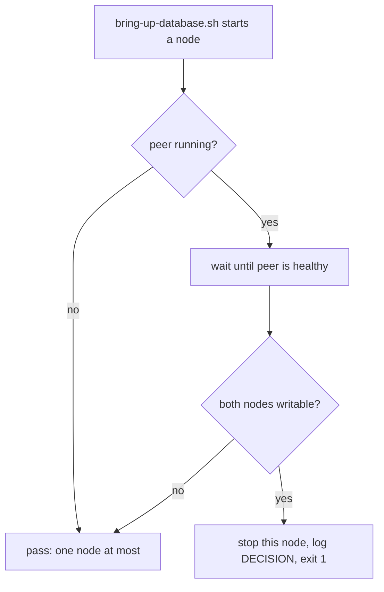

# Split-brain guard

<!-- toc -->

- [Problem](#problem)
- [Mechanism](#mechanism)
- [Guards against](#guards-against)
- [Evidence](#evidence)
- [Limits](#limits)
- [Related](#related)

<!-- tocstop -->

**Pattern:** when a node starts, check whether it has just become a second writer. If it has, stop it again.

## Problem

After a failover, the old primary still holds a writable data directory. If it is started as it was, for example by `docker start` or by a restart policy, it accepts writes alongside the new writer. That is a split-brain.

## Mechanism

| Where | What it does |
|---|---|
| [bring-up-database.sh](../../scripts/bring-up-database.sh), `bring_up` | Starts the container if needed, waits until it is healthy, and then runs the guard. |
| Same script, `guard_against_split_brain` | If the peer is not running, it passes. Otherwise it waits for the peer to be healthy and reads the recovery state of both nodes. If both are writable, it stops this node and exits with status 1. |
| [lib/database.sh](../../lib/database.sh), `database::in_recovery` | Reads `pg_is_in_recovery()`. The value `f` means the node is writable, and `t` means it is a standby. |
| [lib/container.sh](../../lib/container.sh), `container::stop` | Stops the node that should not be writable. |

## Guards against

A failed-over old primary can return as a writer through the project's own start script. This guard stops that.

## Evidence

- **FOV-03** is automated by `test-guards.sh`. The old primary crashed and the standby was promoted. The test then lifted the fence on the old primary, and `bring-up-database.sh` refused the start. The primary was stopped again, and the standby was the only writer. In the control, a start with one writer and one replica was allowed.
- The restore script depends on this guard. After a failed-over run it starts nodes through the same script, so a mistaken start cannot leave two writers (FOV-07).

## Limits

- **The guard applies only when a node starts through `bring-up-database.sh`.** A plain `docker start pg-primary` bypasses it. That start is now fenced, so the node comes up read-only (FOV-10, `test-fencing.sh`). The test lifts that fence to show the guard acting. A node that keeps running is handled by the [lease and guard](lease-and-guard.md).
- **The guard is a snapshot.** Both nodes could become writable a moment after the check. Fencing is the real protection.
- **If the peer is not running, the guard passes.** That is correct, because there is at most one writer. It does mean that a node can come up as a writer alone. The restore script exists to correct that case.
- **The guard relies on the stop succeeding.** If `container::stop` fails, the script stops at that command with the error trace and not the split-brain message, and the node stays writable.

## Related

The [promotion guard](promotion-guard.md) applies the same idea on the operator's side. The [role state machine](../diagrams/role-state-machine.md) shows where this guard refuses a transition.
