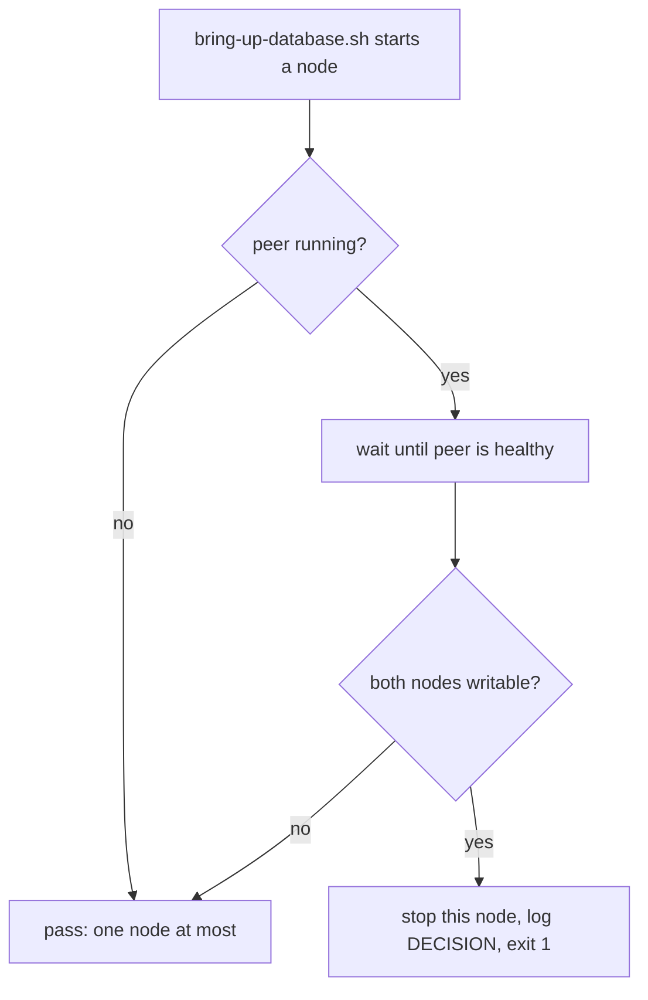

# Split-brain guard

**Pattern:** when a node starts, check whether it has just become a second writer, and if so stop it again.

## Problem

After a failover, the old primary still holds a writable data directory. If it is started as it was (for example
by `docker start`, or by a restart policy), it accepts writes alongside the new writer. That is split-brain.

## Mechanism

| Where | What it does |
|---|---|
| [bring-up-database.sh](../../scripts/bring-up-database.sh), `bring_up` | Starts the container if needed, waits until it is healthy, then runs the guard |
| same script, `guard_against_split_brain` | If the peer is not running, passes. Otherwise waits for the peer to be healthy, reads both nodes' recovery state, and if both are writable stops this node and exits 1 |
| [lib/database.sh](../../lib/database.sh), `database::in_recovery` | Reads `pg_is_in_recovery()`: `f` means writable, `t` means standby |
| [lib/container.sh](../../lib/container.sh), `container::stop` | Stops the node that should not be writable |

## Guards against

A failed-over old primary returning as a writer, through the project's own start script.

## Evidence

- **FOV-03** in the capability register (manual, 2026-11-14): with the old primary stopped and the standby
  promoted, starting the old primary exited 1, logged `DECISION: both writable: stopping pg-primary`, and left the
  container stopped.
- The restore script depends on this: after a failed-over run it starts nodes through the same script, so a
  mistaken start cannot leave two writers (FOV-07).

## Limits

- **It applies only when a node is started through `bring-up-database.sh`.** A plain `docker start pg-primary`
  bypasses it. That start is now fenced (FOV-10, test-fencing.sh): the node comes up read-only. A node that keeps running is handled by the [lease and guard](lease-and-guard.md).
- **It is a snapshot.** Both nodes could become writable a moment after the check. Fencing is the real protection.
- **If the peer is not running, the guard passes.** That is correct (one writer at most), but it means a node can
  come up as a writer alone. The restore script exists to correct that case.
- **It relies on the stop succeeding.** If `container::stop` fails, the script stops at that command with the
  error trace, not the split-brain message, and the node stays writable.

## Related

[Promotion guard](promotion-guard.md) (the same idea on the operator's side), and the
[role state machine](../diagrams/role-state-machine.md), which shows where this guard refuses a transition.
